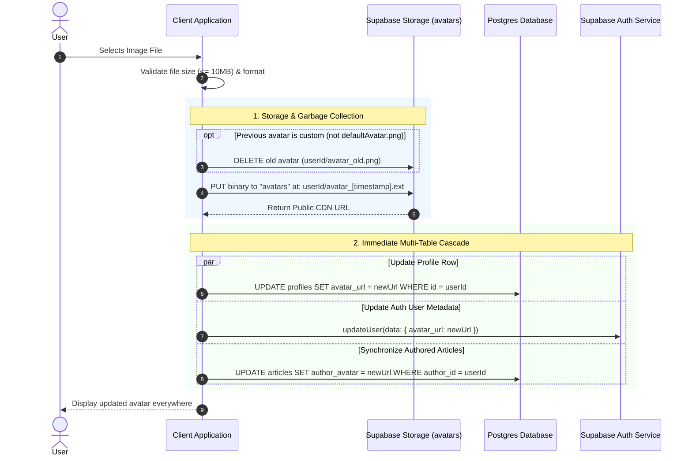
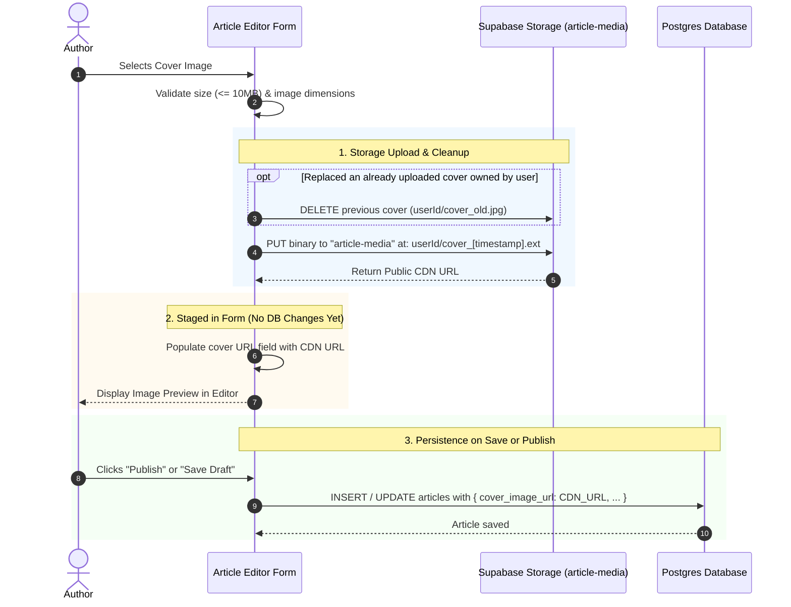
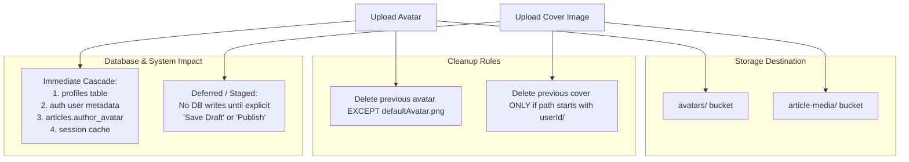

# Image Upload Architecture: Avatar vs. Cover Image Flows

This document details the architectural flows and backend interactions for media management in **MindFeed**, covering both **User Profile Avatars** and **Article Cover Images**, accompanied by visual diagrams and detailed step-by-step breakdowns for each graph.

---

## 1. High-Level Architectural Distinction

The system treats avatar uploads and article cover uploads with two fundamentally different lifecycle strategies:

* **Avatar Upload (Immediate & Cascading)**:
  * Uploading an avatar takes effect instantly upon selection.
  * Immediately triggers database updates across the `profiles` table, Supabase Auth user metadata, and denormalized author columns in `articles`.
* **Cover Image Upload (Staged & Deferred)**:
  * Uploading an article cover only places the file in storage and populates the editor state with the public URL.
  * No database writes occur until the author explicitly clicks **"Save Draft"** or **"Publish"**.

---

## 2. Case 1: Profile Avatar Upload (Immediate Cascading Flow)

### Sequence Diagram

### Step-by-Step Breakdown for Graph 1:

1. **Step 1: Selection & In-Memory Ingestion**
   * The user triggers the image selector in the profile UI.
   * The client reads the selected image file directly into memory as raw binary bytes (`Uint8List`).

2. **Step 2: Client-Side Pre-Validation**
   * The client checks the byte payload length before initiating any network connections.
   * If the payload exceeds **10 MB**, the upload terminates immediately with an error notification, saving device bandwidth and preventing server-side rejections.

3. **Step 3: Previous Avatar Cleanup (Garbage Collection)**
   * The client inspects the user's currently stored avatar path.
   * **Safety Guard**: If the current avatar is `defaultAvatar.png` or empty, deletion is skipped.
   * If the path belongs to an existing custom asset (`userId/avatar_...`), an HTTP delete request removes the old file from the `avatars` bucket to prevent storage bloat.

4. **Step 4: Deterministic Binary Upload**
   * The client constructs a unique, collision-free object key: `{userId}/avatar_{timestamp}.{ext}`.
   * The binary bytes are uploaded to the `avatars` bucket via `uploadBinary` with `upsert: true` and the corresponding MIME header (`image/png`, `image/jpeg`, etc.).

5. **Step 5: Public CDN URL Retrieval**
   * The storage engine generates and returns the publicly accessible edge CDN URL for the uploaded object.

6. **Step 6: Atomic Multi-Table Cascade**
   Because avatars represent a global identity entity across the platform, the client immediately synchronizes multiple persistence layers in parallel:
   * **`profiles` table**: Executes `UPDATE profiles SET avatar_url = newUrl WHERE id = userId`.
   * **Supabase Auth metadata**: Invokes `updateUser(data: { avatar_url: newUrl })` so subsequent auth sessions reflect the updated image.
   * **`articles` table**: Executes `UPDATE articles SET author_avatar = newUrl WHERE author_id = userId` to batch-update the denormalized author image across all published stories.
   * **Local Session Cache**: Caches the new URL in `CurrentUserSession` memory to ensure zero-latency reads on cached views.

7. **Step 7: UI State Finalization**
   * The upload progress indicator is dismissed and all avatar widgets update reactively across the entire application.

---

## 3. Case 2: Article Cover Image Upload (Staged Media Flow)

### Sequence Diagram

### Step-by-Step Breakdown for Graph 2:

1. **Step 1: Cover Asset Selection**
   * The author clicks the "Upload Cover Image" action within the article editor.
   * The image file is ingested directly into memory bytes.

2. **Step 2: Gatekeeping & Dimension Validation**
   * The client verifies that the file is $\le 10\text{ MB}$.
   * The client validates image dimensions to ensure the file complies with standard cover aspect ratios.

3. **Step 3: Intermediate Cover Cleanup**
   * If the author had already uploaded an image during the current drafting session and replaces it, the previous image key is inspected.
   * **Ownership Check**: If the previous path starts with `{userId}/`, the client deletes the replaced file from `article-media` to prevent orphaned drafts from consuming cloud storage.

4. **Step 4: Storage Upload to `article-media`**
   * Generates a unique timestamped key: `{userId}/cover_{timestamp}.{ext}`.
   * The binary bytes are uploaded to the `article-media` bucket with explicit Content-Type headers.

5. **Step 5: CDN URL Resolution & In-Memory Form Staging**
   * The storage engine returns the public CDN URL.
   * **Key Architectural Boundary**: **No database queries are executed at this time**. The public URL is merely placed in the editor's reactive form state.

6. **Step 6: In-Editor Visual Feedback**
   * The editor displays an interactive cover preview. The author continues drafting the headline, markdown content, tags, and category selection.

7. **Step 7: Deferred Database Persistence**
   * Only when the author explicitly taps **"Publish"** or **"Save Draft"**:
     * A database mutation (`INSERT` or `UPDATE` on `articles`) is executed, persisting the entire article payload along with `cover_image_url = CDN_URL`.
   * *If the author cancels or abandons the draft without saving, the database remains completely untouched.*

---

## 4. Architectural Comparison & Decision Logic

### Flowchart

### Step-by-Step Breakdown for Graph 3:

1. **Step 1: Ingestion & Intent Classification**
   * The system determines whether the incoming upload represents an **Identity Asset** (Avatar) or a **Content Asset** (Article Cover).

2. **Step 2: Bucket & Path Isolation**
   * Identity assets route to the `avatars/` bucket under `{userId}/avatar_{timestamp}.{ext}`.
   * Content assets route to the `article-media/` bucket under `{userId}/cover_{timestamp}.{ext}`.
   * Both buckets enforce Row-Level Security (RLS) ensuring that `auth.uid()` matches the first folder segment of the object path.

3. **Step 3: Targeted Garbage Collection Strategy**
   * **For Avatars**: Protects system-level defaults (`defaultAvatar.png`). Custom obsolete avatars belonging to that user are purged.
   * **For Covers**: Scoped strictly to the author's own directory prefix (`{userId}/`). Unowned external image URLs are untouched.

4. **Step 4: Persistence Lifecycle Strategy**
   * **For Avatars**: Synchronous multi-table cascade (`profiles`, `auth.users`, and `articles.author_avatar`) committed immediately upon upload.
   * **For Covers**: Staged in memory and committed asynchronously only when the user executes a form submission ("Save Draft" or "Publish").

---

## 5. Feature Comparison Matrix

| Dimension | User Avatar Upload | Article Cover Image Upload |
| :--- | :--- | :--- |
| **Storage Bucket** | `avatars` | `article-media` |
| **Object Key Pattern** | `{userId}/avatar_{timestamp}.{ext}` | `{userId}/cover_{timestamp}.{ext}` |
| **MIME Content Types** | `image/jpeg`, `image/png`, `image/webp`, `image/gif` | `image/jpeg`, `image/png`, `image/webp`, `image/gif` |
| **Pre-Upload Cleanup** | Deletes previous avatar, skipping `defaultAvatar.png` | Deletes previous cover only if path starts with `{userId}/` |
| **Persistence Timing** | **Immediate**: On upload completion | **Deferred**: On "Publish" or "Save Draft" |
| **Database Tables Affected** | `profiles`, `auth.users`, and `articles` (all author posts) | `articles` (single record) |
| **Row Level Security** | Scoped to `auth.uid() = (storage.foldername(name))[1]` | Scoped to `auth.uid() = (storage.foldername(name))[1]` |
